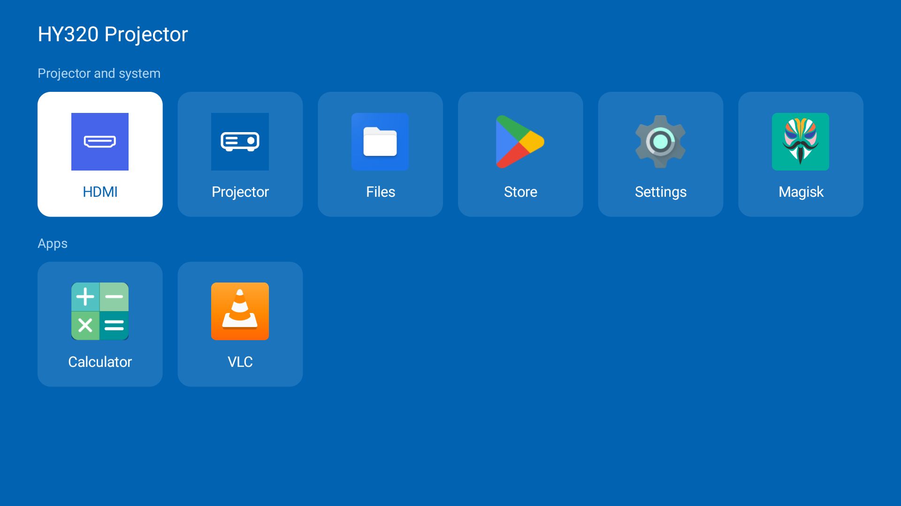
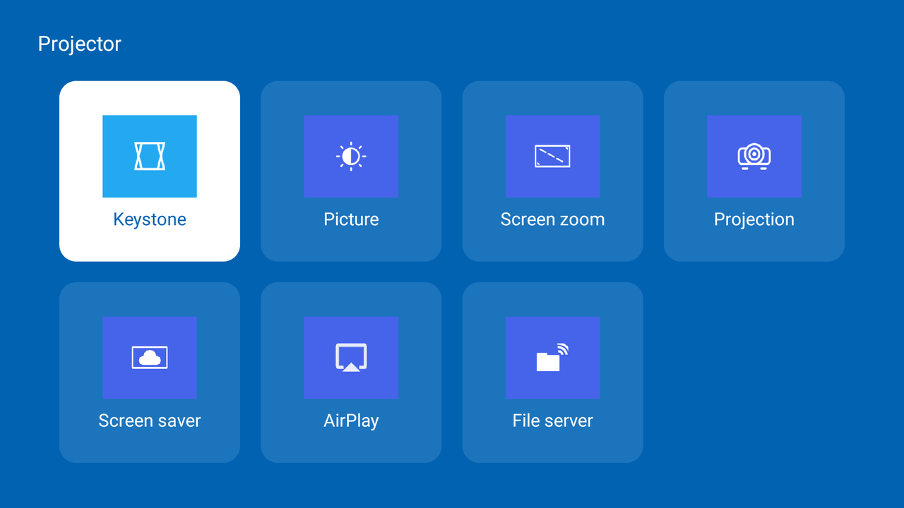
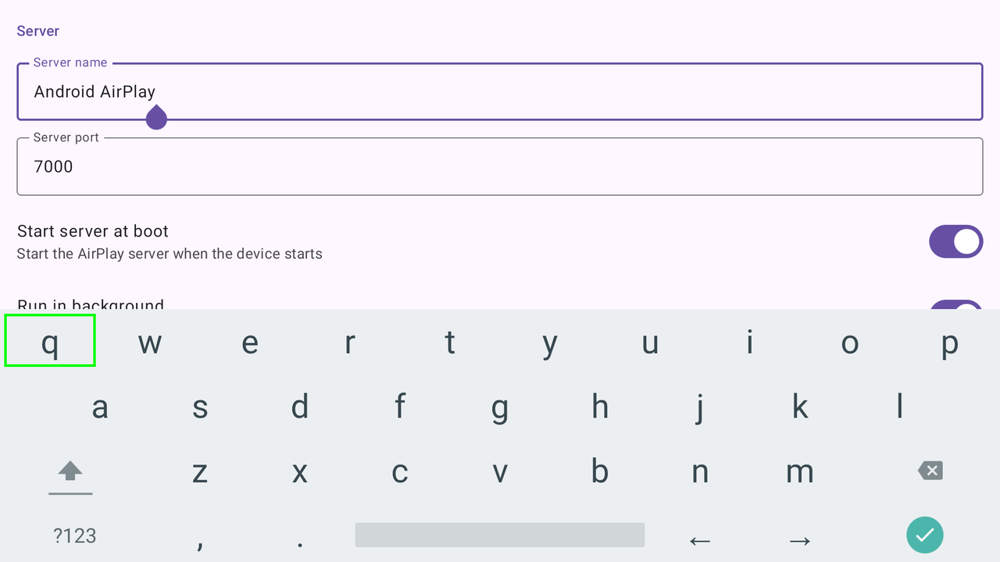
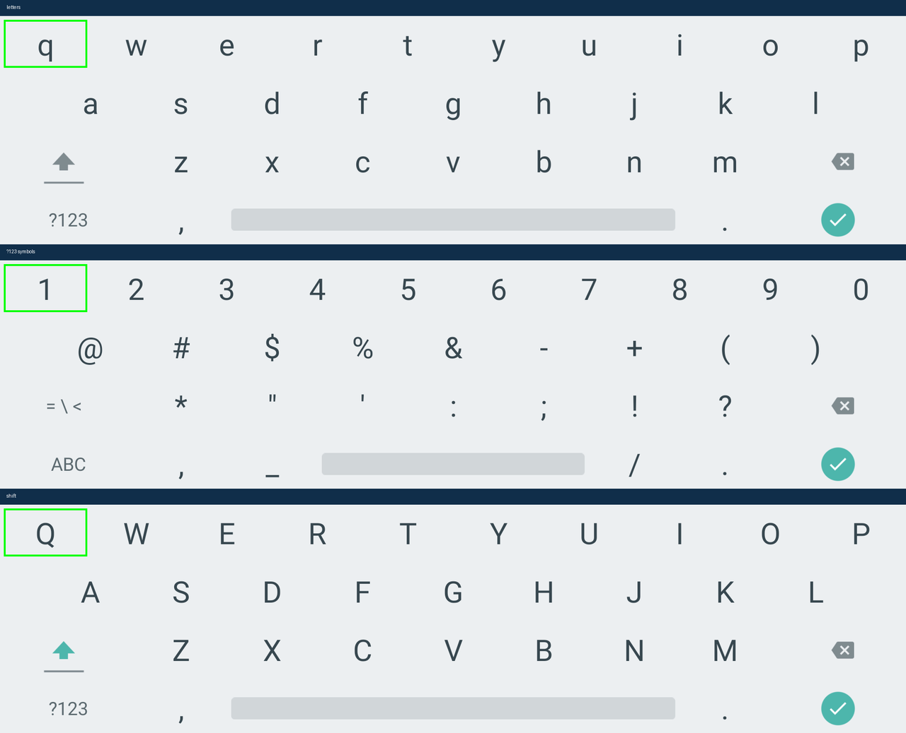

<div align="center">

# Re:HY320

**Taking a cheap Android projector away from its vendor,<br>and giving it back to the person who bought it.**

[](LICENSE)
[](docs/reference/stock-unit/getprop.txt)
[](docs/decisions/07-identify-and-inventory.md)
[](#licence-and-provenance)



</div>

---

The HY320 is a £100 mini projector built on an Allwinner H713, running Android 11.
It is a good little machine with bad software. This repository removes that
software, puts verified boot back together with keys you generate yourself, and
replaces what was lost with software you can read.

It is **not a ROM**. There is no flashable zip. It is the record of taking one
projector apart carefully, with the scripts that did it and the reasoning for
every decision, so that someone with the same projector can do the same thing
and know why.

> [!WARNING]
> **Read [docs/REPRODUCE.md](docs/REPRODUCE.md) before touching your device.**
> You can brick it. Your firmware may not match mine. The backup in step 2 is
> the only way back.

## Contents

- [Why](#why)
- [Features](#features)
- [Getting started](#getting-started)
- [Repository layout](#repository-layout)
- [Limitations](#limitations)
- [Evidence](#evidence)
- [Licence and provenance](#licence-and-provenance)

## Why

The firmware the projector ships with contains, among other things:

| | |
|---|---|
| **Root daemon** | listens for commands |
| **Silent installer** | can add apps without asking |
| **Two Play Protect scripts** | whose only job is to turn Google Play Protect off |
| **Baidu analytics** | inside the vendor settings app, reporting the serial number and MAC address, alongside a `RecoverySystem` update path — running as the system user, so its traffic cannot be firewalled from inside Android |
| **Open adb, from the factory** | the boot ramdisk sets `service.adb.tcp.port=5555`, so unencrypted adb has been listening on every network the projector has ever joined, with no setting anywhere that shows it |

## Features

<table>
<tr>
<td width="50%"></td>
<td width="50%"></td>
</tr>
<tr>
<td><b>The projector's own settings.</b> Keystone, picture, zoom, projection mode, screen saver, AirPlay, the file server, and a way through to Android's own settings — replacing a vendor app that phoned home.</td>
<td><b>A keyboard that works with a remote.</b> Android's own layout, key for key, with the cursor arrows worked into the bottom row.</td>
</tr>
</table>

- **A home screen that keeps no list.** Installed apps are read from the package
  manager every time it comes forward, so anything you install from the Play
  Store is simply there. The stock launcher sorted apps once, on first run, and
  never again. **Hold OK on a tile** for that app's page in Android's settings —
  its permissions, its storage, its Uninstall button. On Android TV that page is
  the only way to reach an app that declares no TV launcher entry: Settings lists
  apps under "See all apps" only if they do, so anything sideloaded from a phone
  APK, Magisk included, is otherwise invisible and cannot be uninstalled at all.

- **Three keys on the remote that did nothing now do something.** The **menu**
  key opens the projector's own settings, and the key under the **cast** symbol
  opens the HDMI input — the firmware aimed that one at a vendor app this
  project removes, so it had been failing on every press since. The key under
  the **source** symbol is deliberately left alone: the firmware already opens
  the Miracast receiver with it, from whatever app is in front, which no
  ordinary app could do. Both top keys are claimed by the system before any app
  sees the press, so the home screen acts on the release instead.

- **A keyboard you can actually type with.** Android's own keyboard gives the
  D-pad to its keys, so the text cursor can never move; HeliBoard gives the
  D-pad to the cursor, so no key is ever focused. Neither is usable with only a
  remote. This one puts the arrows *on the keyboard*, as keys.

- **AirPlay** from an iPad, **Miracast** from a laptop (a Magisk module, off by
  default), and a **password-protected file server** scoped to one folder.

- **Seven days of probation before it touched the home network.** Every
  destination the projector contacted was logged, attributed to the process that
  opened the socket, and explained. The tooling is in
  [`scripts/probation/`](scripts/probation/).

- **Two packages, between them asking for almost nothing.** The keyboard sees
  every password typed on the projector, so it lives in its own package and its
  own process, with no network and nothing else.

  | Package | Permissions |
  |---|---|
  | `com.hy320.tools` | `READ_EXTERNAL_STORAGE`, `WRITE_SETTINGS` |
  | `com.hy320.keyboard` | **none at all** |

<div align="center">



<i>The stock keyboard's three layers, measured off screenshots — colours, key grid, text sizes and icons — and reproduced rather than imitated.</i>

</div>

## Getting started

There is no installer. The work goes, broadly, like this:

1. **Back up** the whole device, verify the image, and prove you can get back.
2. **Clean** the firmware offline, from that backup, using the plan in [`clean/`](clean/).
3. **Rebuild** verified boot with your own keys and flash the result.
4. **Replace** what was removed with the apps in [`app/`](app/) and [`keyboard/`](keyboard/).
5. **Watch it** for a week before it joins your network.

Each of those is a numbered step with its own checks in `REPRODUCE.md`.

| Document | What it is |
|---|---|
| **[docs/REPRODUCE.md](docs/REPRODUCE.md)** | the procedure, step by step, with the warnings first |
| **[docs/EXTERNAL.md](docs/EXTERNAL.md)** | what to download, from where, and the hashes to check |
| **[docs/MAP.md](docs/MAP.md)** | how the pieces relate |
| **[docs/decisions/](docs/decisions/)** | why each decision went the way it did |
| **[docs/research/](docs/research/)** | the investigations behind them |

Scripts that need a folder of your own read it from the environment —
`HY320_BACKUP`, `HY320_BUILD`, `HY320_UBOOT` — and each says so plainly when it
is unset. Nothing here is tied to the machine it was written on.

## Repository layout

```
app/          the projector's own app: home screen, settings, keystone, AirPlay
keyboard/     the keyboard, its own package so it can hold no permissions
magisk/       Magisk modules: vendor settings out, Miracast back, adb shut down
clean/        the plan: what comes out of the firmware, and why for each
scripts/      everything that was actually run, grouped by what it was for
art/          the icon generators
docs/         the procedure, the research, the decisions, the reference dump
```

> [!NOTE]
> `.scratch/` appears throughout the runbook. It is the local working directory —
> firmware dumps, downloaded binaries, test logs, roughly 1.6 GB — and it is not
> published. None of it is mine to redistribute, and much of it is a record of
> one particular house's network.

## Limitations

- **Android 11, with security patches that stopped in February 2022.** This
  stays a device to keep at arm's length. A newer Android was investigated and
  rejected: the unit is 32-bit only, which caps a generic image at Android 12,
  and such an image replaces the system partition — where keystone, the focus
  motor, the remote's service and the HDMI input all live.
- **The framework is still the vendor's modified one.** Its hooks were read and
  carry no suspicious destinations, and the apps they referenced are gone, but
  it is not pristine Android.
- **No DRM keys at all**, so paid streaming is standard definition at best.
- **Google Cast cannot be added.** That was settled at the start.

## Evidence

This was done once, to one projector, by one person. Every number in
[docs/research/](docs/research/) was measured rather than assumed, and the
decisions in [docs/decisions/](docs/decisions/) record what was rejected as well
as what was chosen — including conclusions that later work proved wrong. There
is no test suite, no CI, and no second unit to check against.

The blow-by-blow execution diary is not published. It is a record of one evening
after another on one person's home network, and nothing in it is needed to
repeat the work: what you need is the procedure, the research and the clean
plan, which are all here.

## Licence and provenance

The code, scripts and documents here are MIT licensed — see [LICENSE](LICENSE).

Two exceptions, neither mine to license:

- `app/assets/icon_mode_*.png` are the projector's own tile icons, taken off the
  vendor settings app on the device this project is about. `art/make-art.py`
  draws replacements if you would rather not have them.
- `keyboard/assets/key_*.png` are cropped from Android's own keyboard as it
  renders on this device (AOSP, Apache-2.0).

**No vendor firmware, no vendor APKs and no signing keys are in this repository.**
